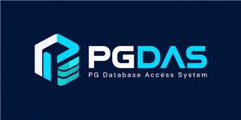

# PGDAS — PostgreSQL Database Access System

A web admin for PostgreSQL. Browse servers, databases, roles, schemas, tables, views, functions and more; run SQL; create
and drop databases and users; and keep an audit log of everything people do. Built with Django; nothing to install but
PGDAS itself, which keeps its own data in a single SQLite file.

**Status: in development.** Queries run in a `READ ONLY` transaction enforced by PostgreSQL itself, with a statement
timeout and a row cap. Staff users can also change data, structure, databases and users, each change after a warning
popup and recorded in the audit log (see "Changing data"). Backups are done (see "Backups"); monitoring, size trends and alerts are done (see "Monitor" and "Alerts & trends") (see the
roadmap).

**Upgrading from the earlier name (PgDeck):** the Python package is now `pgdas`, the settings are `PGDAS_*` instead of
`PGDECK_*`, the data file is `data/pgdas.sqlite3` instead of `data/pgdeck.sqlite3` (move it, with any `-wal` and `-shm`
files next to it, while PGDAS is stopped) and the Docker volume is `pgdas-data`. Rename the variables in your `.env`;
`PGDECK_*` names are no longer read.

## Features
- One Object Browser in the sidebar, laid out like pgAdmin's:
  - **Server:** Databases, Roles (login and group roles, with their memberships), Tablespaces.
  - **Database:** Catalogs (`pg_catalog`, `information_schema`), Extensions, Event Triggers, Publications, Schemas.
  - **Schema:** Tables, Views, Materialized Views, Functions, Procedures, Sequences, Types / Domains. Tables also show
    Columns, Constraints, Indexes and Triggers.
  - Every object has a Properties tab and the `CREATE` SQL for it. Role SQL never includes a password.
  - A **system** switch in the sidebar also shows built-in `pg_*` roles and objects installed by extensions.
- Sign in with local accounts; staff users manage servers and see the audit log, everyone signed in can browse.
- Save several PostgreSQL servers. Passwords are encrypted at rest and never shown again.
- SQL runner: queries run read-only with a 30 s timeout and a 1000-row cap. Staff users can also run INSERT, UPDATE, DELETE,
  TRUNCATE, DROP, CREATE, ALTER, GRANT and REVOKE (databases and users included) with warning popups and typed
  confirmation (see "Changing data").
- Query history: the SQL page lists your own latest 20 statements on that server; click one to reuse it.
- Audit log of every SQL run, server change and data change (staff only), as JSON, with a Re-insert button for deletes and an Undo button for updates.
- Resizable, collapsible sidebar, themed scrollbars and optional interface sounds (mute button in the header).

## Changing data (staff only, with popups and a safety net)
Staff users have full access on every saved server: there are no per-server switches. What a change can actually do is
limited by the PostgreSQL role saved for the server (use one with just the rights you want PGDAS to have). Everyone else
stays read-only. Each kind of statement asks first:

| Statement | How it asks |
|---|---|
| `INSERT` | Runs at once. |
| `UPDATE` | A popup with the **number of rows** it changes and a warning if it has **no WHERE**, then a button. |
| `DELETE` | A popup with the row count; you type **`ZAP`**. |
| `TRUNCATE`, `DROP` | A warning popup; you type **`TRUNCATE`** or **`DROP`**. |
| `CREATE`, `ALTER` | A popup listing what changes; a risky `ALTER` asks for **`ALTER`**. |
| `CREATE`/`ALTER`/`DROP` `DATABASE` and `ROLE` (`USER`, `GROUP`), `GRANT`, `REVOKE` | A popup listing what changes. Dropping asks for **`DROP`**; a role with `SUPERUSER`, `CREATEROLE`, `REPLICATION` or `BYPASSRLS` asks for **`CREATE`**/**`ALTER`**. |

Every change is checked first in a transaction that is always rolled back, run for real only if the facts you were shown are
still true, and recorded in the audit log (as JSON) *before* it is committed, so nothing changes without a record. Any
other statement, and anything typed with scripting switched off, still runs read-only.

- **UPDATE:** the popup shows the count, a sample of the rows as they will look, and any other tables a trigger would
  change. The old and new values of every updated row are saved in the audit log (as JSON), with an **Undo** button. Undo
  puts back the changed columns, all or nothing, and only if no updated row was changed or deleted again since. It needs a
  primary key and at most `PGDAS_MAX_UNDO_ROWS` rows (10 000 by default); otherwise the popup says the update cannot be undone.
  Side effects of triggers are not undone.
- **INSERT:** the audit record holds the statement and the number of rows. `INSERT … RETURNING` shows what came back.
- **TRUNCATE:** the popup lists each table and its row count (with `CASCADE`, also the tables that point at it). The
  rows are **not** saved, because a table can hold millions; the audit record keeps the tables and counts.
- **DROP** (tables, views, materialized views, indexes, sequences, schemas, functions, procedures, types, domains,
  triggers, extensions, publications): the popup shows the rows that go with a dropped table and everything `CASCADE`
  would take along. The audit record keeps the `CREATE` statement of dropped tables for reference. `DROP TABLESPACE`
  and `DROP OWNED` are not available here.
- **CREATE / ALTER:** the statement is tried in the rolled-back transaction and the popup lists exactly what would be created or changed (tables, columns, indexes, constraints, sequences...). A plain `CREATE` or `ALTER` needs just a button; an `ALTER` that drops, renames, changes a type or owner, or takes another object with it asks you to type **`ALTER`**. The audit record keeps the changes and the previous `CREATE` of an altered table or view. `CREATE TABLESPACE`, temporary objects and `CONCURRENTLY` are not available.
- **Databases, users and grants:** roles and grants are tried in the rolled-back transaction and the popup lists the roles, memberships and privileges that change. `CREATE DATABASE` and `DROP DATABASE` cannot run inside a transaction, so they are described from the catalogs and cannot be rolled back (`DROP DATABASE` shows the size and open connections). In the Object Browser, the **Databases** list has **Create database** (a tabbed dialog like pgAdmin's: General, Definition, SQL) and **Rename** and **Delete** on every row, plus **Details**, which opens the database in the tree; the **Roles** list has **Create login / group role** (General, Definition, Privileges, Membership, SQL). Every dialog shows the SQL it will run and, on Save, the same review popup as the SQL runner. **Passwords are never kept:** the popup, the audit log and the history show `PASSWORD '********'`. The role saved for the server needs the matching PostgreSQL rights (`CREATEDB`, `CREATEROLE`, grant option).
- **Permissions are PostgreSQL's.** Whoever has the host, user and password of a role can do what that role may do, so PGDAS adds no rules of its own on top for staff. Anything the role is not allowed is refused with PostgreSQL's own reason (for example `permission denied for table x`, `must be owner of table x`, `permission denied to create role`). `CREATE DATABASE` and `DROP DATABASE` cannot be tried out in a rolled-back transaction, so the role's rights are checked up front and the refusal comes before any popup asks for a typed word. When PostgreSQL only warns (for example `no privileges were granted` for a `GRANT` the role may not make), the popup shows that warning.
- **Security tab on Create database.** Like pgAdmin's: add rows of grantee (a role or PUBLIC) with CREATE, TEMPORARY, CONNECT or ALL, each optionally WITH GRANT OPTION. The SQL tab shows them as GRANT statements after the CREATE DATABASE, and the review popup lists them. The roles are checked first; if PostgreSQL refuses a GRANT after the database exists, the database stays and you are told which statement failed. In the SQL runner the same works as `CREATE DATABASE x; GRANT ... ON DATABASE x ...;` (only GRANT or REVOKE on that same database may follow).
- Each takes **one plain statement at a time** (no `WITH`, no `RETURNING` on UPDATE/DELETE) and, for row changes,
  ordinary tables only.

### Deleting rows
On such a server, a `DELETE` typed into the SQL runner works like this:
1. **Check:** PGDAS runs it inside a transaction that is always rolled back, and shows a popup with the **number of
   records** that would be deleted, a sample of them, whether the statement has no `WHERE`, and any *other* tables it
   would also change (`ON DELETE CASCADE`, triggers).
2. **Warning:** the popup says there is **no rollback** and asks you to type **`ZAP`** in capital letters (`zap`, `Zap`
   or a stray space does not count). The Delete button stays disabled until the box holds exactly `ZAP`.
3. **Delete:** PGDAS runs it again and commits only if the number of rows and the side effects are still exactly what
   you confirmed; otherwise nothing is deleted and you are asked to check again.
4. **Record:** every deleted row is saved in the audit log as **JSON** (database, schema, table, the statement, the
   column names and each row, with types kept: numbers, nested JSON, arrays, NULLs). The record is saved *before* the
   delete is committed: if it cannot be saved, nothing is deleted. A failed or refused attempt is logged too.
5. **Re-insert:** in the audit log, **Re-insert N rows** (after a confirmation popup) puts the rows back, all or nothing,
   once per record. **Download JSON** gives the whole record.

Limits, on purpose: one plain `DELETE FROM table …` at a time (no `WITH`, no `RETURNING`); ordinary tables only; at most
`PGDAS_MAX_DELETE_ROWS` (default 10,000) rows per delete, because each is stored for re-insertion. Rows removed by
`ON DELETE CASCADE` or a trigger are shown in the popup but are **not** saved, so re-insert cannot bring them back.
Re-insert fails, and changes nothing, if a row with the same key now exists or a column was dropped. Give the PostgreSQL
login only the rights it needs (for example `DELETE` on the tables staff may clear): PGDAS can only do what that login may.

## Where PGDAS keeps its own data
PGDAS needs **no database server of its own**. Its users, saved servers, audit log and sessions are stored in one
SQLite file, `data/pgdas.sqlite3` (change it with `PGDAS_SQLITE_PATH`). The file and its folder are created on
first start. **Back it up** by copying the file while PGDAS is stopped, or with `sqlite3 data/pgdas.sqlite3 ".backup copy.sqlite3"`.
SQLite allows one writer at a time, which is plenty for a team browsing and querying; it is not meant for dozens of
people writing at the same moment.

The PostgreSQL servers you *browse* are separate: you add them in the app.

## Quick start with Docker (server or local)
``bash
cp .env.example .env        # then set PGDAS_SECRET_KEY
docker compose up -d --build
docker compose exec pgdas python manage.py createsuperuser
``
Open http://localhost:8000. The data lives in the `pgdas-data` volume. The port is bound to localhost; put an https
reverse proxy (Caddy, nginx) in front before exposing it, then set `PGDAS_ALLOWED_HOSTS`,
`PGDAS_CSRF_TRUSTED_ORIGINS` and `PGDAS_SECURE_COOKIES=1`.

## Quick start without Docker (Windows, macOS, Linux)
Requires Python 3.12+. No database to set up.
``bash
python -m venv .venv
.venv/Scripts/activate       # Linux/macOS: source .venv/bin/activate
pip install -r requirements.txt
cp .env.example .env         # set PGDAS_DEBUG=1 for local use, or PGDAS_SECRET_KEY for a server
python manage.py migrate
python manage.py createsuperuser
waitress-serve --listen=127.0.0.1:8000 pgdas.wsgi:application
``
Use the virtual environment's Python (the `.venv` above), not your system Python, or packages will be missing.

## Connecting to the databases you manage
Use **Add server** and give a name, host, port, a PostgreSQL role with read access (for example
`GRANT pg_read_all_data TO pgdas_reader;`), its password and an SSL mode. There is no database to fill in:
PGDAS logs into a database the role can open (it tries `postgres`, then a database named after the role, then
`template1`) and the tree lists only the databases that role is allowed to connect to. Adding a server never
creates or changes anything on it. PGDAS never needs write access. Use `sslmode=require` or stronger for
remote servers.

## Security notes
- Never expose PGDAS on the public internet without https and access restrictions (VPN or IP allow-list).
- `PGDAS_SECRET_KEY` signs sessions and, unless you set `PGDAS_ENCRYPTION_KEY`, derives the key that encrypts saved
  passwords. Changing it makes saved passwords unreadable; edit each server and re-enter its password.
- `data/pgdas.sqlite3` holds password hashes and encrypted server passwords: keep it out of git (it is ignored),
  out of shared folders, and readable only by the account that runs PGDAS.
- Read-only is enforced by PostgreSQL (`BEGIN READ ONLY`), not by filtering SQL text.

## Tests
PGDAS's own data uses SQLite, so most tests need nothing. The explorer tests browse a real PostgreSQL server and
create and drop a scratch database `pgdas_test_target` on it, so they need a login that can create databases:
``bash
# in .env, or as environment variables
PGDAS_TEST_PG_HOST=localhost
PGDAS_TEST_PG_PORT=5432
PGDAS_TEST_PG_USER=postgres
PGDAS_TEST_PG_PASSWORD=...
python manage.py test
``
Without a reachable PostgreSQL those tests are skipped and say why.

## Backups
Staff can open **Backups** in the sidebar to back up a database now (a `pg_dump` custom-format file), download or delete it, and
restore it. A restore always goes into a **new** database (typed word `RESTORE`), so nothing existing is overwritten; owners and
privileges are not restored. If a restore fails, the half-made database is dropped again.

Schedules (every N hours, keep the newest M) are carried out by `python manage.py run_backups`, which makes the backups that are
due. Run it from Task Scheduler or cron every few minutes, or keep it running with `python manage.py run_backups --loop`. Only
scheduled backups are pruned; manual ones stay until you delete them. Every backup, download, restore and delete is in the audit log.

Settings (`.env`): `PGDAS_PG_BIN` is the folder holding `pg_dump` and `pg_restore` (blank = look on `PATH`; for example
`C:\Program Files\PostgreSQL\18\bin`), `PGDAS_BACKUP_DIR` is where the files go (default `data/backups`). The saved password is
handed to the tools through the environment, never on the command line. Copy the backup folder off the machine as well.

## Monitor
Staff can open **Monitor** in the sidebar to see what a server is doing right now, refreshed every few seconds: all client sessions
(user, database, application, client address, state, how long the query has run, the query), **blocked sessions** with the session
that blocks each one, **slow queries** (active longer than a limit you set), and, when `pg_stat_statements` is installed, the
costliest statements. **Cancel query** (`pg_cancel_backend`) and **End session** (`pg_terminate_backend`) are on each row and are
recorded in the audit log. As everywhere in PGDAS, PostgreSQL decides what the login may do: without the right (for another user's
session, `pg_signal_backend` or superuser) its own "permission denied" is shown. A login with limited rights also sees blank
details for other users' sessions, as PostgreSQL itself hides them.

## Dashboard
Signing in lands on the **Dashboard** (also first in the sidebar), for every user. It reads each saved server live: tiles for
servers (online / offline), databases (and their total size), PGDAS users and alerts; a **server status** table (version, sessions
against `max_connections`, databases, size, online or not, with the reason when a server does not answer); **health** gauges for
connections in use, cache hit ratio and busy sessions; the **total size** of all servers over 24 hours, 7 or 30 days (from the
size samples, see below); the **largest databases**; and, for staff, the **recent activity** from the audit log and a **needs
attention** list (the alerts below plus failed changes of the last 7 days). It refreshes every 30 seconds. PostgreSQL cannot report
the CPU, memory, disk or network use of the machine it runs on, so those are not shown.

## Alerts & trends
**Alerts & trends** (staff) lists what needs attention on a server, worked out each time the page is opened (nothing is stored or
sent): sessions blocked by locks, sessions idle in a transaction too long, queries running too long, connections near
`max_connections`, a database that grew fast over 7 days, a server that cannot be reached, and scheduled backups that failed or are
overdue. Below it, a table of database sizes with the change over 24 hours, 7, 30 or 90 days and a small trend line.

Size history is built by `python manage.py run_watch`, which takes one sample of every database of every saved server (every 5
minutes with `--loop`, or from Task Scheduler or cron); **Sample now** on the page takes one by hand. Samples are kept for 90 days.
The thresholds are settings in `.env` (`PGDAS_WATCH_*`, see `.env.example`). Alerts show on the page, and can also be sent (see "Sending alerts").

## Sending alerts
Set a **webhook** and/or **email** in `.env` (see `.env.example`) and `python manage.py run_watch` (the same job that takes the size
samples) sends the alerts, so you hear about a problem without watching the page:
- a message when an alert **starts**, one when it is **over**, and a reminder every `PGDAS_ALERT_REPEAT_HOURS` (12 by default, 0 =
  never) while a **critical** one lasts. A problem whose numbers change ("3 sessions blocked" then "5") is still the same alert;
- the webhook takes a JSON POST (`text` and `content`), so a Slack, Teams or Discord incoming-webhook address works. Treat the
  address as a secret: PGDAS shows only its host, never writes it to the audit log, and takes it only from `.env`;
- email uses SMTP (`PGDAS_EMAIL_HOST`, `_PORT`, `_USER`, `_PASSWORD`, and `PGDAS_EMAIL_TLS=1` for port 587 or `PGDAS_EMAIL_SSL=1` for 465)
  and goes to `PGDAS_ALERT_EMAIL_TO`;
- if a send fails the reason is recorded in the audit log and it is tried again at the next run;
- nothing is sent, and nothing remembered, until a channel is set. **Send a test notification** on the Alerts & trends page checks
  the settings. `run_watch --no-notify` takes samples only.

## Roadmap
1. MVP: login, servers, object browser, read-only SQL, audit log.
2. Safety: opt-in write mode — **INSERT, UPDATE, DELETE, TRUNCATE, DROP, CREATE and ALTER with popups, typed confirmation, JSON audit
   and re-insert for deletes and undo for updates are done**; query history is done; next: finer per-user permissions.
3. Backups: **`pg_dump` backups, download, restore into a new database, schedules with retention are done.**
4. Monitoring: **sessions, locks, slow queries, cancel/end, size trends and alerts are done**; alerts can be sent by webhook or email.
5. Open-source release: docs, screenshots, CI, one-line installer, Windows service.

## License
MIT — see [LICENSE](LICENSE).
